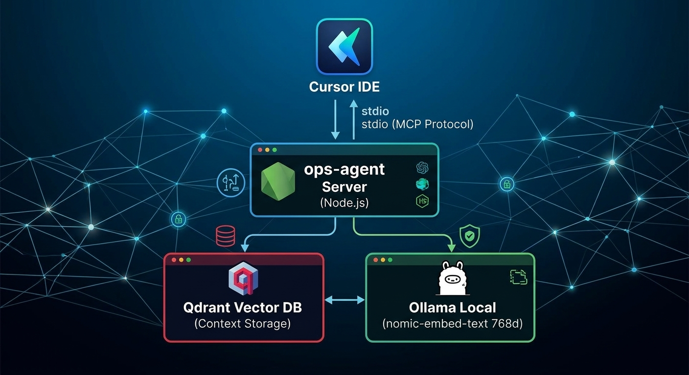
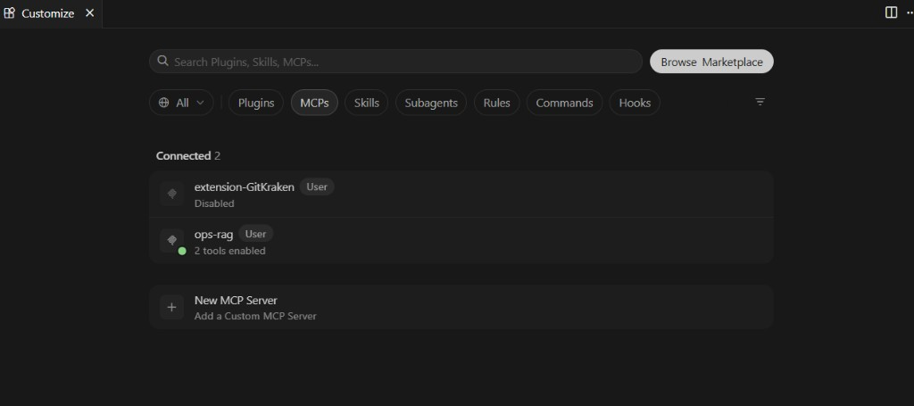

# ⚡ ops-agent

> **A lean, local-first Model Context Protocol (MCP) orchestrator.** Connects Cursor IDE with private vector storage (Qdrant) and local embeddings (Ollama) to achieve secure, zero-latency context retrieval.


---

## 🏛️ High-Level Architecture Overview

This project provides a **thin core: library + playbooks** to operate software products using **Cursor (or any other MCP client)** as the primary communication channel. Think of it as a decentralized agentic workflow environment for senior developers.




### Scope: What It Is vs. What It Is Not

| Is | Is Not |
|----|--------|
| Workspace manifest + job execution inbox | A standalone web GUI |
| Tailored Cursor skills (`ops-triage`, `ops-job`, …) | A monolithic SaaS product |
| Local MCP stdio server + prompt playbooks | A remote messaging replacement |

---

## 🔧 Setup, Ingestion, and Implementation Guide

This section outlines how to configure the local infrastructure, ingest project knowledge bases, and deploy automation playbooks.

### 1. Local Backend Prerequisites

The RAG core requires the following services running locally:

- **Qdrant** server (Vector Database).
- **Ollama** server with the `nomic-embed-text` (768d) model downloaded.
- **Greenfield Setup:** You can use the provided [`mcp-rag/docker-compose.example.yml`](mcp-rag/docker-compose.example.yml) to quickly launch both services (ports `11434` / `6333`).

### 2. Quickstart and Build

1. Open the project root folder in Cursor.
2. Build the MCP server:
   ```bash
   cd mcp-rag && npm install && npm run build
```
3. Configure the MCP server within your client (see wiring details in [mcp-rag/README.md](https://www.google.com/search?q=mcp-rag/README.md)).

### 3. Workspace Ingestion & Configuration

Peer products (apps, bots, APIs) **do not** live inside this core repository. They are orchestrated via a local manifest (`workspaces.yaml`).

1. Copy the template:
```bash
cp workspaces.example.yaml workspaces.yaml
# Edit absolute paths to your local repositories

```


2. Add an entry for each peer product you want to orchestrate:
```yaml
- id: my-product
  path: /absolute/path/to/repo
  role: product # or library
  tags: [tag1]
  notes: One-line summary of the repository's purpose.

```


### 4. MCP RAG (Knowledge Retrieval) Implementation

The stdio server in [`mcp-rag/`](https://www.google.com/search?q=mcp-rag/) indexes your local Markdown files into **Qdrant** using **Ollama** embeddings.

* **Global User Rule:** Add (or paste) the global User Rule in **Customize → Rules → User Rules** (text located at `~/.cursor/rules/prefer-ops-rag.PASTE-INTO-USER-RULES.txt`). Pass `project_id` according to the target product (`ops-agent`, `autobot`, `omnicast`, …).
* **Repository Rule:** Refer to [`.cursor/rules/prefer-indexed-knowledge.mdc`](https://www.google.com/search?q=.cursor/rules/prefer-indexed-knowledge.mdc) — performs targeted queries using `search_knowledge_base` instead of parsing whole directory trees.

*Expected UI in Cursor: `ops-rag` green status with 2 tools enabled (`search_knowledge_base` + `sync_project_docs`).*

---

## 📖 Operational Loop, Skills, and Execution Examples

The workflow is designed to minimize manual intervention while preserving full engineering control. The AI agent operates as a junior Individual Contributor (IC) guided by the senior engineer/PM.

### The Operational Loop

```text
scan → propose (3 jobs) → approve → execute → Needs review
  ↘ escalate (1 question) ↗

```

1. **Triage:** Request **ops-triage** or *"What are we working on this week?"*. The agent scans the inbox and proposes exactly 3 actionable jobs.
2. **Approval:** Approve a job: *"Execute job #2"* or use the `ops-job` skill trigger.
3. **Execution:** The agent completes the task within strictly scoped boundaries.
4. **Decision Escalation:** If product ambiguity arises, the agent invokes `ops-escalate` (asks a single target question with options).

### Skill Catalog (Located in `.cursor/skills/`)

| Skill | Purpose & Usage |
| --- | --- |
| `ops-triage` | Scans the inbox and proposes exactly 3 viable jobs. |
| `ops-job` | Executes an approved job within defined constraints. |
| `ops-escalate` | Pauses execution and asks 1 target product question with options. |
| `ops-decision-log` | Appends architectural or product decisions to doc logs. |
| `ops-scope-guard` | Enforces guardrails (no store publishing, no force-pushes, no ad-bot mutations). |
| `ops-legal` | Generates preliminary Privacy / Terms / Copyright drafts (not legal advice). |

### Optional SkillHub Pack

You can install a curated set of additional generic skills listed in [`docs/ops/skillhub-pack.md`](https://www.google.com/search?q=docs/ops/skillhub-pack.md):

```bash
./scripts/install-skillhub-pack.sh

```

---

## 🚀 Phase 2 (Future Roadmap)

* Integrated product launch and freelance scanning skills.
* Cursor Automations / SDK cron jobs for continuous flows.
* Remote messaging integrations for *Needs decision* alerts and digests.

---

## 📄 License
MIT © [Heriberto Hernández](https://github.com/heribertolord96)


   
