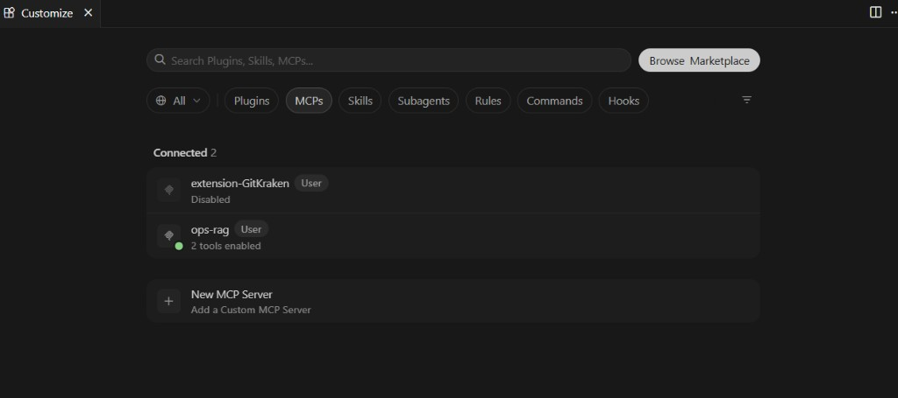
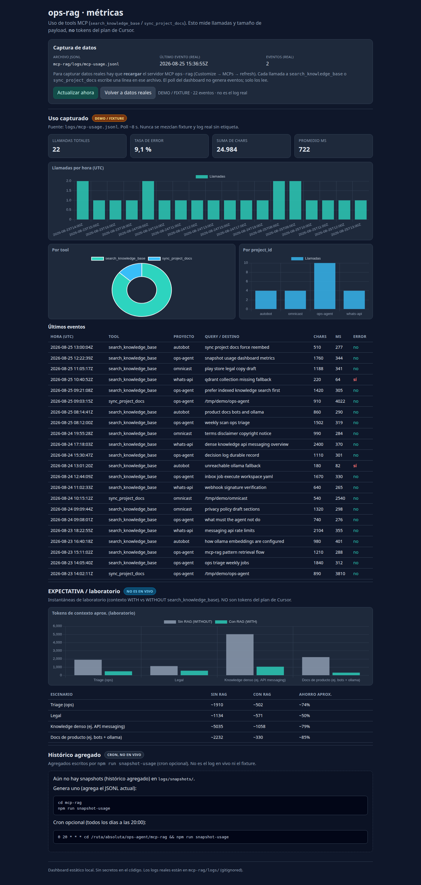

# ops-mcp-rag

Servidor **MCP (stdio)** para agentes: indexa Markdown de un proyecto en **Qdrant** y busca con embeddings de **Ollama**.

## Flujo de recuperación

1. **Primero** `search_knowledge_base` (Qdrant + embedding de la query).
2. El agente **opcionalmente** abre solo los `.md` / paths que aparecen en los hits.
3. **No** leer el árbol completo del repo “por si acaso”.

El ahorro de tokens **solo** aplica si el agente usa la tool de búsqueda en lugar de lecturas masivas de Markdown. Ver números en [Comparativa de tokens](#comparativa-de-tokens-with-vs-without) y [`docs/ops/mcp-rag-pattern.md`](../docs/ops/mcp-rag-pattern.md).

## Requisitos

Necesitas:

- Un servidor **Qdrant** (HTTP, típicamente `http://127.0.0.1:6333`)
- Un servidor **Ollama** con el modelo de embeddings **`nomic-embed-text`** (vectores **768d**)

### Greenfield (Docker)

Compose mínimo (solo Ollama + Qdrant):

```bash
cd mcp-rag
docker compose -f docker-compose.example.yml up -d
docker exec -it ops-rag-ollama ollama pull nomic-embed-text
```

Archivo: [`docker-compose.example.yml`](docker-compose.example.yml). Los datos van en volúmenes Docker; **no** commits de storage Qdrant.

### Reutilizar backends ya existentes

Si en la máquina ya corren Ollama/Qdrant (p. ej. containers de otro proyecto en `11434` / `6333`), apunta las mismas URLs. Usa una **colección dedicada** (`ops_knowledge`) para no mezclar con otros índices.

```bash
curl -s http://127.0.0.1:11434/api/tags | grep nomic-embed-text
# si falta:
ollama pull nomic-embed-text
# o vía container: docker exec <ollama-container> ollama pull nomic-embed-text
```

Variables típicas:

| Variable | Ejemplo |
|----------|---------|
| `OLLAMA_URL` | `http://127.0.0.1:11434` |
| `QDRANT_URL` | `http://127.0.0.1:6333` |
| `EMBEDDING_MODEL` | `nomic-embed-text` |
| `EMBEDDING_DIM` | `768` |
| `QDRANT_COLLECTION` | `ops_knowledge` |
| `DEFAULT_PROJECT_ID` | `ops-agent` |

## Otros clientes MCP

El servidor habla **MCP stdio**. En principio encaja con clientes agentic que soporten MCP por stdio (Cursor; y setups tipo Claude Code / Codex **si** exponen MCP stdio).

No hay un único archivo universal: **cablea `command` / `args` / `env` en la config MCP de cada cliente**.

## Build

```bash
cd mcp-rag
cp .env.example .env   # opcional
npm install
npm run build
```

`dist/` está en `.gitignore`; siempre `npm run build` tras clonar o cambiar TypeScript.

## Estado, smoke y logs (sin daemon)

MCP por **stdio no es un demonio**: el cliente arranca `node dist/index.js` (o el wrapper) cuando hace falta.

Cada llamada MCP a `search_knowledge_base` / `sync_project_docs` (éxito, error o fallback) escribe **una línea JSON** en `logs/mcp-usage.jsonl` y el mismo JSON en **stderr**. Eso mide **uso de tools**, no tokens del plan de Cursor.

| Comando | Para qué |
|---------|----------|
| `npm run status` | Backends (Ollama + modelo, Qdrant + puntos en `ops_knowledge`), Node, `dist/index.js` |
| `npm run smoke` | End-to-end: health → sync fixture → search (CLI; **no** escribe usage JSONL) |
| `npm run sync-docs -- …` | Indexar Markdown de un directorio |
| `npm run search -- …` | Probar `search_knowledge_base` desde la CLI |
| Cursor → **Settings → MCP** / **Customize → MCPs** | Servidor `ops-rag` healthy cuando está cargado |

### UI esperada en Cursor

Verifica en **Customize → MCPs** (o Settings → MCP): `ops-rag` en verde con **2 tools enabled** (`search_knowledge_base` + `sync_project_docs`). Otros servidores (p. ej. GitKraken Disabled) son opcionales y no afectan a ops-rag.



*UI esperada: `ops-rag` en verde con 2 tools enabled.*

### Uso de tools (JSONL) — no es ahorro del plan de Cursor

El gráfico de usage de Cursor **no** refleja el ahorro de RAG. Este log local sí cuenta cada tool call.

Archivo (gitignored, junto a `logs/mcp.log`): `mcp-rag/logs/mcp-usage.jsonl`

Ejemplo de línea (`search_knowledge_base`):

```json
{"ts":"2026-08-25T15:21:00.123Z","tool":"search_knowledge_base","project_id":"ops-agent","query":"ops triage weekly jobs","hit_count":5,"chars":1840,"is_error":false,"ms":312}
```

Ejemplo (`sync_project_docs`):

```json
{"ts":"2026-08-25T15:22:10.456Z","tool":"sync_project_docs","project_id":"ops-agent","target_dir":"/absolute/path/to/ops-agent","files":12,"chunks":48,"chars":620,"is_error":false,"ms":4120}
```

`query` se trunca a 120 caracteres. No se registran cuerpos de archivos, `.env` ni credenciales.

Contar y agrupar:

```bash
cd mcp-rag

# llamadas totales
wc -l logs/mcp-usage.jsonl

# por tool
jq -r .tool logs/mcp-usage.jsonl | sort | uniq -c

# errores / fallbacks
jq 'select(.is_error == true)' logs/mcp-usage.jsonl

# searches por project_id
jq -s 'map(select(.tool=="search_knowledge_base")) | group_by(.project_id) | map({project_id: .[0].project_id, n: length})' logs/mcp-usage.jsonl

# chars devueltos (aprox. del payload MCP, no tokens de Cursor)
jq -s 'map(.chars) | add' logs/mcp-usage.jsonl
```

**Esto no es ahorro de tokens del plan de Cursor.** Solo indica cuántas veces se usó ops-rag y el tamaño del payload. El ahorro de contexto ocurre si el agente **usa** la búsqueda en lugar de leer todos los `.md`.

### Dashboard de métricas (local)

UI estática (`dashboard/index.html` + JS, Chart.js por CDN). **No abras el HTML como `file://`**: el navegador bloqueará `fetch`.

Servidor Node propio (no `npx serve`; `/` es la app, no un listado de archivos):

```bash
cd mcp-rag
npm run dashboard
```

Abre [http://127.0.0.1:3000/](http://127.0.0.1:3000/). Escucha `127.0.0.1:3000` (o `PORT` / `HOST` en el entorno). `/dashboard` redirige a `/`. Assets (`/styles.css`, `/app.js`, fixtures, `benchmark.json`) y logs (`/logs/mcp-usage.jsonl`, `/logs/snapshots/*`) salen del mismo origen. No hay directory listing del repo.

| Panel | Qué es |
|-------|--------|
| **Uso capturado** | `logs/mcp-usage.jsonl` (etiqueta **DATOS REALES**). Si el archivo no existe, el vacío lo dice: no es un mock. **Ver fixture** carga demo opcional (etiqueta **DEMO / FIXTURE**). |
| **EXPECTATIVA / laboratorio** | `dashboard/benchmark.json` (WITH vs WITHOUT). No es uso en vivo ni tokens del plan. |
| **Histórico agregado** | `logs/snapshots/index.json` escrito por cron/`npm run snapshot-usage`. No es el log en vivo. |



*Esto es **DEMO / FIXTURE**, no el JSONL en vivo ni tokens del plan de Cursor.*

```bash
npm run snapshot-usage
```

Cron opcional (20:00, una vez al día):

```
0 20 * * * cd /absolute/path/to/ops-agent/mcp-rag && npm run snapshot-usage
```

Si el mismo día se corre otra vez, el archivo diario `YYYY-MM-DD.json` no se pisa: se escribe un `YYYY-MM-DDTHHMMSS.json`. `logs/` (incluye `snapshots/`) sigue gitignored.

### Logs stderr opcionales (`mcp.log`)

El servidor ya escribe usage en `mcp-usage.jsonl` aunque `mcp.json` apunte directo a `node dist/index.js`. El wrapper **además** duplica **stderr** (JSON de usage + fatales) a `logs/mcp.log`. `stdout` queda limpio para MCP.

```bash
npm run start:logged
# o en mcp.json: command = ruta a scripts/run-with-log.sh (ver abajo)

npm run logs
# o: tail -f logs/mcp.log
```

## Indexar varios proyectos

Cada producto usa un `project_id` distinto en la misma colección `ops_knowledge`. Sync ocasional; search frecuente.

```bash
# Desde mcp-rag/, pasa --dir absoluto al repo del producto
npm run sync-docs -- \
  --dir /absolute/path/to/ops-agent \
  --project-id ops-agent

npm run sync-docs -- \
  --dir /absolute/path/to/product-docs \
  --project-id my-product

# Re-embeber aunque el hash no haya cambiado:
npm run sync-docs -- --dir ./fixtures --project-id ops-smoke --force
```

Omitidos automáticamente: `node_modules`, `vendor`, `dist`, `build`, `.git`, `storage`, `sail`, etc. Se indexan directorios `.cursor` (p. ej. skills).

### Cómo el agente usa los datos

1. **Sync** (de vez en cuando): `sync_project_docs` o `npm run sync-docs` cuando cambian docs.
2. **Search** (a menudo): `search_knowledge_base` con `project_id`.
3. El índice vive en Qdrant; el proceso MCP solo habla stdio — no “mantiene” el índice en memoria.

```bash
npm run search -- --query "ops triage" --project-id ops-agent --limit 3
```

## Comparativa de tokens (WITH vs WITHOUT)

Mediciones internas aproximadas (contexto sin RAG → con `search_knowledge_base`):

| Escenario | Sin RAG | Con RAG | Ahorro aprox. |
|-----------|---------|---------|---------------|
| Triage (ops) | ~1910 | ~502 | ~74% |
| Legal | ~1134 | ~571 | ~50% |
| Knowledge denso (ej. API messaging) | ~5035 | ~1058 | ~79% |
| Docs de producto (ej. bots + ollama) | ~2232 | ~330 | ~85% |

**Importante:** el ahorro solo se materializa si el agente **usa** `search_knowledge_base` y no sustituye eso por leer todos los `.md` del árbol.

## Herramientas MCP

### `sync_project_docs`

Escanea `.md` / `.mdx`, omite archivos con el mismo SHA-256, trocea por headings / párrafos, embebe en serie con Ollama y hace upsert en Qdrant.

Args: `target_dir`, `project_id?`, `force?`, `include_mdx?`

### `search_knowledge_base`

Embebe la query y busca en Qdrant filtrando por `project_id`.

Args: `query`, `project_id?`, `limit?`

Si Ollama o Qdrant no responden, ambas tools devuelven un mensaje de fallback a lectura local de archivos.

## Cursor (`mcp.json`)

Añade en la config MCP del cliente (User o Project). Usa placeholders; ajusta a tu clon:

```json
{
  "mcpServers": {
    "ops-rag": {
      "command": "node",
      "args": [
        "/absolute/path/to/ops-agent/mcp-rag/dist/index.js"
      ],
      "env": {
        "OLLAMA_URL": "http://127.0.0.1:11434",
        "QDRANT_URL": "http://127.0.0.1:6333",
        "EMBEDDING_MODEL": "nomic-embed-text",
        "EMBEDDING_DIM": "768",
        "QDRANT_COLLECTION": "ops_knowledge",
        "DEFAULT_PROJECT_ID": "ops-agent"
      }
    }
  }
}
```

En Cursor también puedes resolver rutas relativas al workspace con variables del cliente si las soporta (p. ej. `${workspaceFolder}/mcp-rag/dist/index.js`).

Luego reinicia MCP / el cliente y prueba:

1. `sync_project_docs` con `target_dir` = docs del producto.
2. `search_knowledge_base` con una query.

### Wrapper `run-with-log.sh` (recomendado para medir uso)

Tras cambiar `mcp.json`, **recarga MCP** (Customize → MCPs → refresh / restart `ops-rag`). Sin recarga, Cursor sigue el proceso viejo.

```json
{
  "mcpServers": {
    "ops-rag": {
      "command": "/absolute/path/to/ops-agent/mcp-rag/scripts/run-with-log.sh",
      "args": [],
      "env": {
        "NODE_BIN": "/absolute/path/to/node",
        "OLLAMA_URL": "http://127.0.0.1:11434",
        "QDRANT_URL": "http://127.0.0.1:6333",
        "EMBEDDING_MODEL": "nomic-embed-text",
        "EMBEDDING_DIM": "768",
        "QDRANT_COLLECTION": "ops_knowledge",
        "DEFAULT_PROJECT_ID": "ops-agent"
      }
    }
  }
}
```

`NODE_BIN` es opcional si `node` está en el PATH del proceso MCP. Si hoy usas el binario de nvm, pon esa misma ruta en `NODE_BIN`.

Ejemplo LOCAL (no lo versionamos): `command` = `/home/pablo/Documents/Heriberto/ops-agent/mcp-rag/scripts/run-with-log.sh` y `NODE_BIN` = `/home/pablo/.nvm/versions/node/v24.19.0/bin/node`.

### Nota LOCAL (opcional)

Si trabajas en un clon concreto, sustituye el placeholder por la ruta real a `mcp-rag/dist/index.js` (o al wrapper) en tu disco. No hace falta versionar esa ruta en el repo.

## Variables de entorno

Ver [`.env.example`](.env.example).
